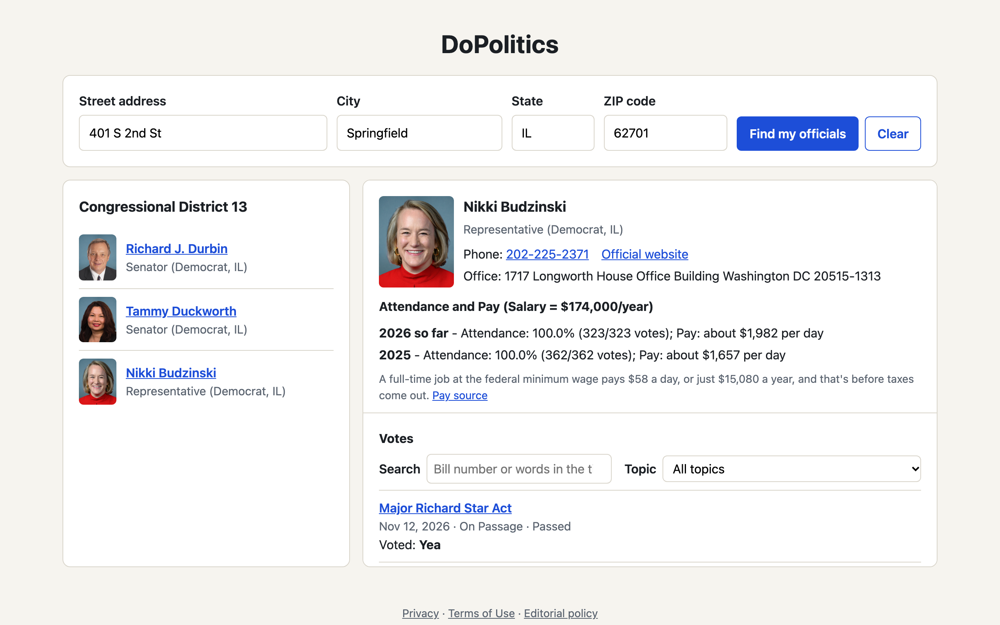

# DoPolitics

[](https://github.com/jrwiegsDev/do-politics/actions/workflows/ci.yml)

People say "I don't do politics." Politics does all of us.

DoPolitics takes a street address and returns every federal official who represents it: two U.S. senators and one U.S. representative. For each official it shows recent votes, each with the official summary of the bill it concerns, and every way to contact them. There's no signup, no account and no donation ask.

**Status:** live at **[dopolitics.org](https://dopolitics.org)** since November 15, 2026. Enter a street address and see your two senators and your representative, how often each one shows up to vote and what they're paid, their recent roll call votes, and the bill behind each vote with its official summary. It runs on Render: a FastAPI web service, a managed Postgres database with PostGIS, and six cron jobs that pull new votes, bills and members from government sources on a schedule.



**Stance:** This is a project to illustrate how politics affects all of us, and that conservative representation often creates or exacerbates problems rather than solving them. It may be labeled a progressive project, but the reality is that the GOP has controlled all three branches of government from January 20, 2025 until the 2026 midterms, and no one's life has gotten better. Its data comes from official government sources, and every summary links to the record it summarizes.

## How it works

```
[Government sources] -> [Scheduled ingestion jobs] -> [Postgres + PostGIS] -> [Read-only API] -> [Web app]
                                                                                     ^
                                     [Census Geocoder] ------------------------------+  (per request)
```

1. **Geo-resolution.** The address is geocoded to a point with the U.S. Census Geocoder. A point-in-polygon query against congressional district boundaries, loaded from Census TIGER/Line into PostGIS, then finds the district. Boundaries are stored in-house, so no third-party service decides who represents an address.
2. **Ingestion, not proxying.** Officials, contact info and votes come from government sources on a schedule. Each source has an adapter that fetches, normalizes and upserts the data, keyed on stable IDs so re-runs are safe, and every run is logged. User requests are answered from our own database. The geocoder is the only live call.
3. **Districts change.** Districts are modeled with effective dates, so a mid-decade redistricting doesn't quietly serve the wrong representative.

## v1 scope

- Federal only: U.S. Senate and U.S. House
- Contact: DC office phone and address, official website, and contact form where the office has one
- Attendance and pay for the current and previous year
- Recent roll call votes, each with the bill it concerns, how the parties voted, how the bill moved (including passage by voice vote), the official summary, and a plain-language summary once one has been reviewed
- Bill Search: any bill of the 119th Congress onward, by its number, words in its title (or the start of a word) and its topic, with no address needed; laws come first, then bills that got a roll call
- State legislators and governors come after v1

## Privacy

Addresses are never stored. An address is sent once to the Census Geocoder, resolved to districts and discarded. It isn't cached, it isn't logged, and it never goes into a URL. The site sets no cookies, uses no analytics service and loads nothing from other sites. It does keep a few daily totals of its own, such as lookups per state and views per bill, with nothing about any visitor attached (see [Usage counts](#usage-counts)). The full policy, including how IP addresses are handled (held in memory for about a minute by the rate limiter, and kept for 14 days in Render's request logs), is the site's [Privacy Policy](app/templates/privacy.html) at `/privacy`, alongside the [Terms of Use](app/templates/terms.html) at `/terms`.

## Summaries

Every bill shows its official summary: the Congressional Research Service summary, as published on Congress.gov, with the stage of the bill it describes, its date, and a link to the bill's page. A bill with no official summary says so.

Plain-language summaries, and a short "How this does you" callout, are written by Claude from that official summary and follow the published [editorial policy](docs/editorial-policy.md). Each is labeled as generated beside the official summary it came from. A draft nobody has reviewed yet is marked "Not yet reviewed by human eyes" and holds back its "How this does you" callout until a person approves it; a rejected one is never shown. See [Generated summaries](#generated-summaries).

## Stack

| Layer | Choice |
|---|---|
| API | Python, FastAPI, Uvicorn, httpx2, psycopg with a psycopg_pool connection pool |
| Web app | Jinja2 templates served by the same FastAPI app, HTMX, a hand-written stylesheet |
| Database | PostgreSQL + PostGIS |
| Migrations | Alembic, written as plain SQL |
| Ingestion | Python, psycopg, pyshp, Beautiful Soup |
| Dependencies | uv |
| Local dev | Docker Compose (Postgres 18 + PostGIS 3.6) |
| Testing | pytest, pytest-cov, Playwright (pytest-playwright) end-to-end in Chromium |
| CI | GitHub Actions |
| Hosting | Render |

## Local development

Requires [Docker Desktop](https://www.docker.com/products/docker-desktop/) or another Docker runtime with Compose.

1. Copy the example environment file and set a password. Avoid `$` in the value, because Compose treats it as a variable reference.

   ```
   cp .env.example .env
   ```

2. Build the database image and start it in the background. The first build takes a few minutes.

   ```
   docker compose up -d --build
   ```

3. Confirm the container is healthy. The health check runs a PostGIS query, so `healthy` means the extension is enabled.

   ```
   docker compose ps
   ```

4. Create the tables. This needs [uv](https://docs.astral.sh/uv/), which installs the Python dependencies on first run.

   ```
   uv run --env-file .env alembic upgrade head
   ```

5. Load the district boundaries for every state. This downloads 56 files from the Census and takes a few minutes. Use a FIPS code such as `--state 17` to load one state.

   ```
   uv run --env-file .env python -m ingest.congressional_districts --state all
   ```

6. Load the current members of Congress. This is one small download and takes a few seconds.

   ```
   uv run --env-file .env python -m ingest.officials
   ```

7. Load everyone who has ever served in Congress. This downloads a larger file (about 13 MB) and takes a few seconds longer.

   ```
   uv run --env-file .env python -m ingest.members
   ```

8. Load the roll call votes, one chamber at a time. This is one download per vote with a short pause between them, so a full session takes several minutes. Add `--limit 3` to try it on a few votes first.

   ```
   uv run --env-file .env python -m ingest.votes --chamber house
   uv run --env-file .env python -m ingest.votes --chamber senate
   ```

   With no session named, the loader works out the current one from today's date. To load an earlier session, name it with `--congress 119 --session 1`.

9. Load the bills those votes name, with their official summaries. This needs a free key from [api.congress.gov/sign-up](https://api.congress.gov/sign-up), set as `CONGRESS_API_KEY` in `.env`. It is one or two requests per bill and takes several minutes. Add `--limit 3` to try it on a few bills first.

   ```
   uv run --env-file .env python -m ingest.bills
   ```

10. Start the API. `--reload` restarts it when a file changes.

   ```
   uv run --env-file .env uvicorn app.main:app --reload
   ```

   The web app is then at `http://127.0.0.1:8000/` and the API's interactive documentation at `http://127.0.0.1:8000/docs`.

The database listens on `127.0.0.1:5433` by default, so it doesn't collide with a Postgres already running on 5432. Change `POSTGRES_PORT` in `.env` to use another port.

The image is built from `db/Dockerfile`: the official `postgres:18` image plus the PostGIS packages. The official `postgis/postgis` image has no arm64 build, so building our own keeps it native on Apple silicon.

To refresh the screenshot at the top of this README, run `uv run python scripts/screenshot.py` while the dev server is up (or add `https://dopolitics.org` to shoot the live site). It drives a real Chromium through a lookup for the Illinois State Capitol and saves the whole page, title to footer, as `docs/screenshot.png`.

To stop the database, run `docker compose down`. Data is kept in a named volume. To delete the data as well, run `docker compose down -v`.

## Deploying

The site runs on [Render](https://render.com), described in `render.yaml` (a Render Blueprint), so every infrastructure change is reviewed in a pull request like code. One project, `dopolitics`, in the Ohio region:

| Resource | What it does |
|---|---|
| `dopolitics` (web, Starter) | The app. Built with `uv sync --frozen --no-dev` (exactly the versions in `uv.lock`, without test tools), Python from `.python-version`. Each deploy runs `alembic upgrade head` first, then starts one uvicorn worker. Deploys automatically when a commit to `main` passes CI; the cron jobs rebuild on the same rule. Serves `dopolitics.org`. |
| `dopolitics-db` (Postgres 18, 1 GB RAM, 5 GB disk) | Reachable only from Render's private network: its IP allow list is empty. |
| `load-votes`, `load-bills` | Daily new roll calls, then every bill of the 119th Congress onward that is new or changed (at most 8,000 a run), starting with any bill a new vote names. |
| `draft-new-summaries`, `revise-summaries` | Daily drafts for new bills and bills that moved to a newer stage (at most 20; only bills with a roll call or that became law), and rewrites: approved summaries whose note asks for a change, and rejected ones. Each within $5 of worst-case cost, sending what fits. |
| `load-members-and-officials`, `load-photos` | Weekly and monthly. |

Each service gets only the secrets it uses: the web app has only the database URL, and the Congress.gov and Claude API keys sit in two environment groups attached only to the jobs that call those APIs. Their values are entered in the Render Dashboard and never appear in the file. Cron schedules are in UTC, at hours that are overnight in every US time zone.

The routines for running it, [docs/operations.md](docs/operations.md): reviewing summaries over `render ssh` (the database accepts no connections from the internet, so review runs inside Render), the monthly backup and the check that it restores, recovering the database, and fixing a summary job whose Anthropic key is rejected.

## Schema migrations

The schema is managed with [Alembic](https://alembic.sqlalchemy.org/). Each change is a numbered file in `migrations/versions/`, written as plain SQL. Alembic records the latest revision applied in an `alembic_version` table and runs only the files after it, so the same command builds an empty database or brings an existing one up to date:

```
uv run --env-file .env alembic upgrade head
```

Each migration runs in a transaction, so a failure leaves the schema unchanged. Alembic connects through the same `ingest/db.py` function as the ingestion jobs, so no database URL or password is kept in `alembic.ini`.

To add a change, create the next file with `uv run alembic revision -m "describe the change" --rev-id 0011`, write the SQL in `upgrade()` and its reverse in `downgrade()`. A migration that has been pushed is never edited. A correction goes in a new one.

The only SQL outside the migrations is `db/init/001_extensions.sql`, which enables PostGIS when the local container is first created so its health check can pass.

## District lookup

The `districts` table (`migrations/versions/0001_baseline.py`) holds one row per district, with its boundary as a PostGIS `MultiPolygon` in NAD83 (SRID 4269), the coordinate system the Census publishes in. Each row has `effective_from` and `effective_to` dates so a redrawn map can sit alongside the one it replaces.

Finding the district for a point is one query. Longitude comes first.

```sql
SELECT state_fips, code, name
FROM districts
WHERE ST_Contains(boundary, ST_Point(:longitude, :latitude, 4269))
  AND effective_from <= :on_date
  AND (effective_to IS NULL OR effective_to > :on_date);
```

The query lives in `find_district` in `app/districts.py`. It takes the date as a parameter, which defaults to today, so the tests can check the date filter against a fixed day.

The two date conditions keep the lookup on the map in force on that date. A redrawn map can be loaded ahead of time with a future `effective_from`, and the lookup switches to it on that date with no code change or deploy.

A GiST index on `boundary` keeps this fast. The index compares the point against each district's bounding box first, so the exact geometry check only runs on the one or two districts that could match. With all 441 districts loaded, the lookup still runs in about a millisecond.

### Loading boundaries

`ingest/congressional_districts.py` downloads a state's TIGER/Line file, reads the shapefile in Python and upserts each district. It takes a state's FIPS code, or `all` for the 50 states, DC and the five territories:

```
uv run --env-file .env python -m ingest.congressional_districts --state 17
uv run --env-file .env python -m ingest.congressional_districts --state all
```

The load is idempotent. A unique constraint on `(level, chamber, geoid, effective_from)` identifies a district on a given map, and the insert uses `ON CONFLICT ... DO UPDATE`, so a second run updates the same rows instead of adding duplicates. Add `--dry-run` to read the file and print the rows without writing anything.

The loader connects with `DATABASE_URL` if it's set, and otherwise with the `POSTGRES_*` values from `.env`.

Every load is recorded in the `ingestion_runs` table: the job, the source file, start and finish times, the number of rows written, and the error if it failed. For a failed run, the number is the rows committed before the failure, which the failure cannot undo: a bills run that dies partway keeps and reports every bill it had saved, and an all-or-nothing load such as the districts reports 0. The run is committed as `running` before any data is touched, so a crash still leaves a record. The district rows and the `succeeded` mark are committed together, and on an error the district rows are rolled back and the run is marked `failed`. With `--state all`, each state is its own run and its own transaction, so one failed download doesn't stop or undo the others.

```sql
SELECT source, status, rows_loaded, finished_at, error
FROM ingestion_runs
ORDER BY started_at DESC;
```

Each map's `effective_from` is the date the first Congress elected under it was seated: 2023-01-03 for most states, and 2025-01-03 for the five that redrew before the 2024 election (Alabama, Georgia, Louisiana, New York, North Carolina). The loader looks this up by state.

Any other map needs its Congress, TIGER/Line release and start date given. The maps for the 120th Congress, seated 2027-01-03, load ahead of time:

```
uv run --env-file .env python -m ingest.congressional_districts --state all --vintage 2026 --congress 120 --effective-from 2027-01-03
```

Loading a newer map closes the state's older one in the same transaction: the older rows get an `effective_to` equal to the new `effective_from`. Because `effective_to` is exclusive, the old map answers through 2027-01-02 and the new one from 2027-01-03, with no day on which a point falls in two districts or in none. A state that did not redraw still gets new rows, identical to the old ones, so every state switches on the same day.

The Census publishes the map a legislature enacted, even when the courts kept it from being used, so each redrawn state's file is checked against the map its election actually used. `WRONG_MAP_FILES` lists the files that fail that check, and the loader skips them, leaving the state's older map in effect. Missouri's file for the 120th Congress holds its 2025 map, which a referendum petition suspended; the U.S. Supreme Court ordered the 2022 map used for the 2026 election.

## Officials

The `officials` table (`migrations/versions/0003_officials.py`) holds one row per sitting member of Congress: name, party, chamber, state, term dates and DC office contacts (phone, address, website, and a contact form where one is published). `leadership_titles` (`migrations/versions/0010_leadership_titles.py`) lists the party and chamber leadership roles a member holds today, such as "Speaker of the House", read from the same file; most members have none. A vacant seat has no row, so the app can say a seat is vacant instead of showing a placeholder.

`official_terms` (`migrations/versions/0014_official_terms.py`) holds every term each sitting member has served, oldest first, as the same file lists it: chamber, state, district (House only, `0` for at-large), party, start and end dates, and `how` (`appointment` or `special-election`, when the file says). A term has no identifier of its own, so a row is keyed by the member and its position in the list, and it is removed with its member (`ON DELETE CASCADE`).

`ingest/officials.py` loads both from [unitedstates/congress-legislators](https://github.com/unitedstates/congress-legislators):

```
uv run --env-file .env python -m ingest.officials
```

The source and the Census describe a seat differently, and the loader translates once at load time so a district joins to its representative on a plain equality match. `IL` becomes FIPS `17`, and district `13` becomes the text `13`. The source uses district `0` for two cases, which become `00` for a state with a single at-large seat and `98` for the six non-voting seats, matching the Census codes.

The load is idempotent, keyed on the member's Bioguide ID, which stays the same if a member moves from the House to the Senate. Members who are no longer in the file are removed in the same transaction, and each loaded member's terms are replaced as a set, so the officials and their terms never disagree. A download with fewer than 500 members is treated as broken and refused, since loading it would remove everyone it leaves out. Each run is recorded in `ingestion_runs`. Add `--dry-run` to print the rows without writing anything.

### Looking up a seat

`find_officials` in `app/officials.py` returns the sitting members for a state and district: the senators first, then the representative. It filters on term dates the same way the district lookup filters on map dates, so a member whose term has ended is left out even if the data hasn't been refreshed. The end date is exclusive, so a term ending on January 3 and its successor starting that day never both match.

## Photos

The `member_photos` table (`migrations/versions/0008_member_photos.py`) holds one photo per member, as the image itself. A Render server's disk is replaced on every deploy, so a folder of downloaded files would vanish; rows in Postgres do not, and a new photo needs no deploy. Each row also keeps the image's SHA-256, where it was downloaded from, and the credit line its source asks for, if any.

`ingest/photos.py` loads a photo for every sitting member:

```
uv run --env-file .env python -m ingest.photos
```

[unitedstates/images](https://github.com/unitedstates/images) is asked first: its photos are public domain, 225 by 275 pixels, and named by Bioguide ID. When it has none, usually for a member who arrived in a special election, the member's record on the Congress.gov API supplies one, with a credit such as "Courtesy U.S. Senate Historical Office" that the member tile shows under the photo. A member neither source has gets a plain silhouette. Every download must start like a JPEG and be under 1 MB, and the table checks the size again.

The load is idempotent, keyed on the Bioguide ID. A photo whose image and credit are unchanged is not written again, so `updated_at` says when a photo last changed and the run reports how many did. A photo belongs to a row in `members`, so run `ingest.members` and `ingest.officials` first. Each run is recorded in `ingestion_runs`; add `--limit` to stop after a few members.

## Members

`officials` answers "who holds this seat today", and it drops a member the day they leave office. Votes are cast by people, and a member's votes outlast their seat. The `members` table (`migrations/versions/0004_members.py`) is the record of the people: one row for everyone who has ever served in Congress, back to 1789, and nobody is ever removed from it.

`ingest/members.py` loads it from the same project, reading both the current and the historical file:

```
uv run --env-file .env python -m ingest.members
```

Each row holds the member's Bioguide ID, their name, and their Senate LIS ID if they have served there. The House publishes its votes by Bioguide ID and the Senate by LIS ID, so this table is what lets a Senate vote be tied to the same person as everything else. The LIS ID is unique, so two people can never share one.

The table holds everyone, not only the current Congress, because a chamber's roll can name someone with no term in it: the opening roll call of the 119th Congress lists a member-elect who never took his seat. Loading the whole history means a vote can always be tied to a known person, and it is the groundwork for looking up any past member's record.

The load is idempotent, keyed on the Bioguide ID. When a member leaves office the source moves them from the current file to the historical one, and the next run updates their row to match. A read with fewer than 12,000 people is treated as broken and refused. Each run is recorded in `ingestion_runs`. Add `--dry-run` to print the rows without writing anything.

## Votes

Two tables (`migrations/versions/0005_votes.py`) hold the roll calls. `votes` has one row per roll call: chamber, Congress, session, roll number, when it happened, the question, the bill or nomination it concerned, and the result. `vote_positions` has one row per member per roll call, with the member's position and their party and state as recorded that day.

`ingest/votes.py` loads them from the chambers' own records, the [House Clerk](https://clerk.house.gov/) and [Senate.gov](https://www.senate.gov/), which publish one XML file per roll call:

```
uv run --env-file .env python -m ingest.votes --chamber house
uv run --env-file .env python -m ingest.votes --chamber senate --congress 119 --session 1
```

The Congress and session are not written into the loader. `ingest/congress.py` works them out from the date: a Congress lasts two years and is seated on January 3 of an odd year, so January 1 and 2 still belong to the year before. Run without `--congress` and `--session`, the loader takes today's date, loads the session in progress, and also checks the one before it, because a vote cast in a session's last days can be published after the next has begun. When a new Congress is seated the loader moves to it without a code change.

Every roll call is loaded, including quorum calls and procedural votes, and each position is stored exactly as the chamber spells it. That is `Yea` and `Nay` on some votes, `Aye` and `No` on others, `Present`, `Not Voting`, and in the election of the Speaker a candidate's name.

Neither chamber says which votes are final and which are steps along the way, so the loader gives each vote a category, stored in a column added by `migrations/versions/0006_vote_category.py`:

| Category | What it covers |
|---|---|
| `legislation` | Final votes on a bill or resolution: passage, accepting the other chamber's version, a veto override |
| `nomination` | Senate confirmations |
| `procedural` | Everything else: amendments, cloture, motions to proceed, recommit or table, quorum calls |

The rule is `categorize` in `ingest/categories.py`. It reads the vote's question, and for two questions that cover both kinds of vote it reads the title too: a House resolution is `legislation` unless it is a rule setting the terms for debating a bill, and the Senate's catch-all "On the Motion" is `legislation` only for a motion to accept the House's version. A question wording the rule has never seen counts as `procedural`, so nothing is shown as a final vote by mistake, and the loader reports it. When a rule changes, this re-labels the stored votes without downloading anything:

```
uv run --env-file .env python -m ingest.votes --recategorize
```

The loader also records which bill a vote concerns, in two columns added by `migrations/versions/0007_bills.py`. The House writes a bill as `H R 5103` and the Senate as `H.R. 5103`; `bill_for` in `ingest/bills.py` turns both into the type and number Congress.gov files the bill under, `hr` and `5103`. A vote that names no bill, such as a nomination or a quorum call, leaves both columns empty, and a check constraint keeps them filled or empty together. The same `--recategorize` command fills these columns for stored votes.

The same migration creates the `bills` and `bill_summaries` tables, described under [Bills and summaries](#bills-and-summaries).

The two chambers publish different formats, so each has its own parser, and both produce the same rows. The differences they absorb:

- **Member IDs.** The House identifies members by Bioguide ID and the Senate by its own LIS ID. Senate positions are translated through the `members` table, and an ID that can't be translated fails the run instead of dropping a senator's vote.
- **Times.** Both publish Eastern time in different layouts. Each is converted and stored as an exact moment.
- **Finding new votes.** The Senate publishes a list of each session's votes. The House does not publish one a program can rely on, so the loader asks for the roll call after the last one it has, then the next, until one is missing. The Clerk answers a missing roll call with a normal success status and a short error document, so the loader checks the document itself, not the status.

A session is filed under the year it starts in, and a vote cast in the first days of the following January still belongs to it.

Each position must belong to a row in `members` and each belongs to a row in `votes`, enforced by foreign keys, so run `ingest.members` first. A vote and its positions are committed together as soon as they are saved. A run that fails partway is recorded as failed in `ingestion_runs` and keeps what it had saved, and the next run carries on from there. The loader pauses between requests and identifies itself to the source.

## Bills and summaries

Two tables (`migrations/versions/0007_bills.py`) hold the bills. `bills` has one row per bill: its Congress, type and number, title, policy area, sponsor, the date it was introduced, its latest action, and a link to its page on Congress.gov. `bill_summaries` has one row per version of a bill's official summary. The Congressional Research Service writes a summary at each stage a bill reaches, such as "Introduced in House" or "Passed Senate", so a bill can have several, and each row records the stage and its date. `bills.title_search` (`migrations/versions/0011_bill_title_search.py`) holds the title as searchable words, a `tsvector` that Postgres computes itself whenever a title is stored (a generated column), with a GIN index so a search can find every bill containing a word without reading each title.

`ingest/bills.py` loads them from the [Congress.gov API](https://api.congress.gov/):

```
uv run --env-file .env python -m ingest.bills
```

The loader stores every bill of the 119th Congress onward, so a bill can be found whether or not it ever reached a vote: about 20,000 for the 119th, where only a few hundred get a roll call. Each run lists every bill of each Congress from the 119th to the current one, 250 to a request, and downloads only the ones that are new or have changed. The list gives only the day a bill last changed, so a stored bill is downloaded again when it changed on or after the day before its last download: once or twice per change, then not again until it changes. A bill some vote names is downloaded first if it is not stored yet. The 120th Congress is picked up on January 3, 2027 with no code change (`congresses_since` in `ingest/congress.py`).

`--limit` caps how many bills a run downloads, the most recently changed first, and the nightly job uses `--limit 8000`: the roughly 19,500 bills not yet stored when this began are worked through over three nights, and after that a night has a few hundred. A pause after every request keeps a run under 14,400 requests an hour, inside the API's limit of 20,000. A bill whose sponsor is not in `members` yet (a new member's first bill before the weekly members run) is skipped and reported, and tried again the next night; a record that cannot be read is skipped so it cannot block the bills after it, and the run is then marked failed, naming it. A bill whose list of actions or summaries is shorter than its own record counts is never stored. If it changed in the last 24 hours, Congress.gov's list may only be behind its record, so it is left for the next night and reported, and the run still succeeds; if it changed longer ago, it counts as unreadable.

A vote is tied to its bill by Congress, type and number, the same three values on both tables, so the votes loader never has to wait for this one. A vote on a bill that has not been loaded yet simply has no bill attached.

The API key is read from `CONGRESS_API_KEY` and sent in a request header, never in the address, so it cannot end up in a logged URL or in a recorded error.

Summaries are published as HTML. `html_to_text` in `ingest/plain_text.py` converts each one to plain text with [Beautiful Soup](https://www.crummy.com/software/BeautifulSoup/) at load time: a paragraph becomes a block set apart by a blank line, a list item becomes a line starting with a dash, and bold, italics and link addresses are dropped. The API serves only that text, so the web app never has to display markup written by another site. The original HTML is stored beside it and never served, so the conversion can be improved and re-applied later without downloading anything again.

Some bills have no official summary, and some never get one. That is stored as a bill with no summary rows, and the API returns an empty list for it.

**Actions.** `bill_actions` (`migrations/versions/0012_bill_actions.py`) holds every step a bill has taken: introduced, referred to committee, passed by a recorded vote or by voice vote or unanimous consent, sent to the President, signed. This is the only place a bill passed without a roll call shows that it passed, since no vote record names it. The loader asks for a bill's actions alongside its summaries, 250 to a request (the API sends 20 at a time unless asked for more), page by page for the rare bill with more, and refuses the bill if fewer arrive than its record says it has, rather than store part of a bill's history as all of it. A bill whose record lists no actions costs no request for them.

An action has no identifier of its own, and two can be identical: a bill sent to two committees gets one referral row for each. With nothing to match on, an upsert cannot tell a changed action from a new one, so each run replaces the set: it deletes the bill's stored actions and inserts the list just read, in the same transaction that saves the bill. A reader sees the old list or the new one, never a mix or an empty list. Rows are keyed on the bill and their position, oldest step first.

Congress.gov records most steps twice: once in the chamber's own words ("House floor actions", "Senate") and once by the Library of Congress in plain form, such as "Passed/agreed to in House: On motion to suspend the rules and pass the bill Agreed to by voice vote." Every action is stored except one with no words: the Library of Congress sometimes sends a copy of a step without its text (S. 3347's introduction came as both "Intro-S" with no text and "Introduced in Senate"), and that copy is left out, as it has nothing to show. The bill tile and the API show only the Library of Congress steps, and a step it recorded twice under two codes (as with "Introduced in House") is shown once.

The load is idempotent: a bill is keyed on its Congress, type and number, a summary on its bill and version, and a bill's actions are replaced as a set. Each bill is committed with its summaries and actions as soon as it is saved, so a run that fails partway keeps what it had. A bill Congress.gov does not have is reported and skipped; any other failure, such as a refused key, fails the run. Each run is recorded in `ingestion_runs`. Every sponsor must be a row in `members`, so run `ingest.members` first.

### Generated summaries

`ingest/summaries.py` asks Claude for two texts per bill, written from its newest CRS summary: a plain-language summary and a one-to-three-sentence "How this does you" callout. Only bills that a stored roll call names, or that became law, are written up; any other bill is written only when named with `--bill`. Of the thousands of bills introduced in a Congress, those are the ones that reached a recorded vote or changed the law, and the limit keeps the nightly job from drafting bills that never moved. The instructions are in `ingest/prompt.py`, followed by the "How we write about a bill" section of `docs/editorial-policy.md`, so the writing rules readers see are the rules the model follows. The policy's other sections are about the site, not the writing, and are not sent. Each answer is stored in `generated_summaries` (`migrations/versions/0009_generated_summaries.py`) as a draft, with the prompt version, the model, its token counts and what it cost.

The API key is read from `ANTHROPIC_API_KEY` in `.env`. Only these commands send requests, and only when run by hand or on a schedule; the web app never imports the Anthropic SDK, and a test checks that.

```
uv run --env-file .env python -m ingest.summaries estimate --limit 10
uv run --env-file .env python -m ingest.summaries sample --bill 119/hr/498
uv run --env-file .env python -m ingest.summaries submit --budget 6
uv run --env-file .env python -m ingest.summaries sample --new-only --limit 20 --budget 5 --fit-budget
uv run --env-file .env python -m ingest.summaries collect msgbatch_...
uv run --env-file .env python -m ingest.summaries review
uv run --env-file .env python -m ingest.summaries review --previous
uv run --env-file .env python -m ingest.summaries revise
```

- `estimate` counts tokens, which is free, and prints the most the requests could cost.
- `sample` sends requests one at a time and prints each answer, for tuning the prompt.
- `submit` sends them through the Batch API at half price, and `collect` stores the answers once the batch has ended.
- `sample`, `submit` and `revise` refuse to send anything when the most it could cost is over `--budget` dollars. The most is a worst case: every answer counted at its full token allowance, about 2.5 times what a typical summary really costs.
- `--fit-budget` (on `sample` and `revise`, which the nightly jobs use) sends what fits instead: requests in order, each counted at its worst case, skipping one that would cross the budget and still taking smaller ones after it. What is left waits for the next run, and the log names it. An unattended job that refused everything would refuse the same list again every night; this way a busy night spreads over the nights after it. Manual runs keep all-or-nothing, to know before spending.
- `--new-only` keeps only bills with nothing written from their newest CRS summary: bills with no generated summary at all, and bills whose approved text or draft came from an older stage (written from Introduced when the newest is Public Law, say). It is what the nightly job runs, so new bills get a draft the next morning and a bill that moved forward gets one from its new stage, without an older prompt's drafts being written again. The site keeps showing approved text until the newer draft is approved. A rejected bill is redrafted by `revise` (see Rejections below).

**The prompt version.** It is a 12-character fingerprint of the full instructions, so any edit to the prompt or to the policy's writing rules gives a new version (an edit to another section of the policy does not), and every stored answer names the exact instructions it was written under. A new version makes every bill due again, except a bill whose summary is already approved. Naming a bill with `--bill` writes it again anyway.

**Review.** `review` shows each draft beside the CRS summary it came from, one at a time, to approve, reject or skip, with an optional note. Each decision is saved as it is made. `review --previous` first walks the decisions of the last 7 days, newest first, so a mistake can be sent back to the drafts. Times are shown in the local time zone.

**Revisions.** An approval with no note means the text is final. An approval with a note means the text goes live as it is, but the note asks for a change. `revise` sends the approved text and the note back to Claude, with instructions to make that change and keep every other sentence word for word, and stores the result as a new draft that points back to the row it revises. The next `review` shows revisions first, with the date and the note, and the changed words marked `[-removed-] {+added+}`. Approving a revision puts it on the site in place of the original; rejecting it keeps the original. Each row is rewritten only once, so a rejected revision is not tried again on every run unless its rejection asks for that (see below).

**Rejections.** A rejection asks for a rewrite too, so no bill is left with nothing to show. When nothing approved stands for the bill and no draft is waiting, `revise` redrafts it from its newest CRS summary, given the rejected text and the note on it, if any, with instructions to follow the note and not repeat what it names (or, with no note, to write fresh instead of rewording). When the rejected row was a revision of approved text, a note asks for another try: `revise` sends the approved text, its note, the rejected try and the new note; no note means keep the approved text as it is. Either rewrite is stored as a draft that points back to the rejection, and the next `review` shows it first with the date and the note: a redraft in full, another try with its changes from the approved text marked. A redraft shows on the site as not yet reviewed. Only a bill's newest rejection counts, each is rewritten once, and a rejected rewrite is itself a rejection, so every try follows a decision someone made. The nightly `revise-summaries` job runs all of this.

## API

The API is a FastAPI app in `app/main.py`.

Every response carries security headers (`app/security.py`). A strict Content-Security-Policy lets the browser run scripts and styles and load images only from this site; the site can afford one because HTMX and the stylesheet are served from `/static` and no page has inline code. `/docs` and `/redoc` get a looser policy that allows the CDN and inline code FastAPI's interactive docs need. The others: `Strict-Transport-Security` (HTTPS only, for a year), `X-Content-Type-Options: nosniff`, `Referrer-Policy: same-origin`, `X-Frame-Options: DENY` and a `Permissions-Policy` refusing location, camera and microphone. Browser tests walk the whole tile flow, the policy pages and both docs pages and fail on any policy violation the browser reports.
The web app writes one log line per request to standard output (`app/logs.py`), such as `INFO request=00ad2fc528744211 app.requests: GET /health 200 in 3 ms`: method, path, status and time, never the query string or body, so search words and addresses stay out. Every line, from any logger, is tagged with the request's ID: on Render, the ID Render gives the request (the `Rndr-Id` header, also shown in Render's own request logs); elsewhere, a made-up one. An ID from a header is used only if it is 1 to 64 letters, digits or hyphens, so nobody can forge a log line through it. The ID is sent back in an `X-Request-ID` header, and a request that crashes is logged at ERROR with its ID before the 500 goes out. Render checks `/health` every few seconds, so a health check is logged only when it fails. `/` and `/health` answer `HEAD` as well as `GET`, since Render and uptime monitors probe with either. On Render, uvicorn's own access log is switched off (`--no-access-log`), since this line replaces it.

Address lookups are rate-limited (`app/ratelimit.py`): each visitor gets 10 lookups in any 60 seconds, on `POST /lookup` and `POST /tiles/officials`. Past that, the API answers `429 Too Many Requests` with a `Retry-After` header, the page shows a short message in the officials tile, and the Census Geocoder is not asked. The limit is a sliding window: each visitor's recent lookup times sit in a list, times older than a minute drop off, and a lookup is refused while 10 remain, so there is no fixed minute to game. A lock keeps two simultaneous requests from both slipping under the limit. Only a lookup with a valid address counts. Visitors are told apart by IP address: Cloudflare's `CF-Connecting-IP` header, which Cloudflare (in front of every Render service) sets to the connecting address and won't let a visitor send, rather than `X-Forwarded-For`, where Render keeps whatever a visitor wrote at the start of the list, so its first entry could be faked to dodge the limit. Without that header (on a laptop, in tests), the connection's own address is used. The address is held only in the app's memory and forgotten about a minute after their last lookup by a timer that runs every 10 seconds; it is never written to the database or logs. The counts reset when the app restarts, which is fine for one process.

The web app borrows database connections from a pool (`app/deps.py`, using `psycopg_pool`) instead of opening one per request. The pool opens when the app starts, keeping 2 to 10 connections, and closes when it stops; each request borrows one and gives it back, committed if the request succeeded and rolled back if it failed. Opening a connection costs a network round trip and a password check, which adds up once the database is on another server, and Postgres caps how many connections it accepts, so the pool keeps requests fast and the total bounded. The pool reads the database settings at startup, not at import, so the tests can point it at their own database. The loaders and migrations still open a single connection each with `ingest/db.py`'s `connect()`.

| Method | Path | Purpose |
|---|---|---|
| `GET` | `/health` | Confirms the API is up and can reach the database |
| `POST` | `/lookup` | Takes a street address in four fields, returns the district and its members of Congress |
| `GET` | `/members/{bioguide_id}/votes` | Returns a member's most recent votes, newest first |
| `GET` | `/bills/{congress}/{bill_type}/{bill_number}` | Returns a bill and its official summaries |
| `GET` | `/photos/{bioguide_id}.jpg` | Returns a member's photo |

```
curl -X POST http://127.0.0.1:8000/lookup \
  -H 'Content-Type: application/json' \
  -d '{"street": "401 S 2nd St", "city": "Springfield", "state": "IL", "zip_code": "62701"}'
```

The address is four fields, not one line, so nobody has to guess where the commas go. `Address` in `app/address.py` holds the rules, and the API and the web app both use it: a street is required, with either a ZIP code or a city and state. The state is its two-letter abbreviation and the ZIP code is five digits.

```json
{
  "district": {"state_fips": "17", "code": "13", "name": "Congressional District 13"},
  "senators": [{"name": "...", "party": "...", "phone": "...", "website": "..."}],
  "representative": {"name": "...", "party": "...", "phone": "...", "website": "..."}
}
```

Each senator and the representative also carry `has_photo` and `photo_credit`. When `has_photo` is true, the photo is at `/photos/{bioguide_id}.jpg`.

A request runs three steps: `geocode` in `app/geocoder.py` asks the Census Geocoder for the address's coordinates, `find_district` finds the district containing that point, and `find_officials` returns who holds its seats. `lookup` in `app/lookup.py` joins the last two.

| Outcome | Response |
|---|---|
| Address resolved | `200` with the district, senators and representative |
| House seat is vacant | `200` with `"representative": null` |
| DC or a territory | `200` with an empty `senators` list |
| Address not found, or outside every district | `404` |
| Street missing or too short, no ZIP code and no city with a state, or a malformed state or ZIP code | `422` |
| Census Geocoder unreachable | `503` |

The lookup is a `POST` with the address in the request body on purpose. A `GET` would put the address in the URL, and URLs are written to access logs by web servers and proxies. The HTTP client's own request logging is turned down for the same reason, and a geocoder failure is reported by its type only, because the full error message contains the request URL.

### A member's photo

```
curl -i http://127.0.0.1:8000/photos/D000563.jpg
```

The answer is the JPEG, with two headers that let a browser skip asking for it again. `Cache-Control: public, max-age=86400` lets it reuse the photo for a day without asking. After that it asks again and sends the `ETag` it was given in an `If-None-Match` header. The ETag is the photo's SHA-256, so when it still matches, the answer is `304 Not Modified` with no body, and the image is not sent twice. A member with no stored photo gets `404`, and an ID that is not a Bioguide ID gets `422`.

### A member's votes

```
curl "http://127.0.0.1:8000/members/B001315/votes?limit=2"
```

```json
{
  "member": {"bioguide_id": "B001315", "name": "Nikki Budzinski"},
  "votes": [
    {
      "chamber": "house", "congress": 119, "session": 2, "roll_number": 314,
      "voted_at": "2026-09-16T23:05:00Z",
      "question": "On Motion to Suspend the Rules and Pass",
      "issue": "S 2403", "title": "Retire through Ownership Act",
      "result": "Passed", "category": "legislation",
      "source_url": "https://clerk.house.gov/evs/2026/roll314.xml",
      "position": "Yea",
      "bill": {
        "congress": 119, "bill_type": "s", "bill_number": 2403,
        "title": "Retire through Ownership Act",
        "policy_area": "...",
        "source_url": "https://www.congress.gov/bill/119th-congress/senate-bill/2403"
      }
    }
  ]
}
```

`find_recent_votes` in `app/votes.py` joins `vote_positions` to `votes` for one member. The member's ID comes from the `/lookup` response. It is a public identifier, unlike an address, so it is part of the URL.

Each vote carries the bill it concerns, joined from `bills` with a `LEFT JOIN` so a vote with no bill is still returned. `bill` is `null` for a vote that names no bill, such as a confirmation, and for a bill that has not been loaded yet. The three values in it are the address of the bill's own endpoint.

| Parameter | Default | Meaning |
|---|---|---|
| `limit` | `20` | How many votes to return, from 1 to 100 |
| `show` | `final` | `final` returns final votes on legislation and Senate confirmations. `all` adds procedural votes |

| Outcome | Response |
|---|---|
| Member found | `200` with the member and a list of votes, which is empty if they have none |
| No member has that ID | `404` |
| Malformed ID, `limit` out of range, or unknown `show` | `422` |

Times are exact moments in UTC. Each vote links to the chamber's own record of it.

### A bill and its summaries

```
curl http://127.0.0.1:8000/bills/119/hjres/20
```

```json
{
  "congress": 119, "bill_type": "hjres", "bill_number": 20,
  "title": "Providing for congressional disapproval under chapter 8 of title 5, ...",
  "policy_area": "Energy",
  "sponsor_bioguide_id": "P000609", "sponsor_name": "...",
  "introduced_on": "2025-01-15",
  "latest_action_on": "2025-05-09", "latest_action": "Became Public Law No: 119-6.",
  "source_url": "https://www.congress.gov/bill/119th-congress/house-joint-resolution/20",
  "summaries": [
    {"version_code": "49", "action_on": "2025-05-09", "action_desc": "Public Law", "summary_text": "..."},
    {"version_code": "00", "action_on": "2025-01-15", "action_desc": "Introduced in House", "summary_text": "..."}
  ],
  "actions": [
    {"acted_on": "2025-01-15", "action_text": "Introduced in House"},
    {"acted_on": "2025-05-09", "action_text": "Became Public Law No: 119-6."}
  ]
}
```

`find_bill` in `app/bills.py` reads the bill, then its summaries, newest stage first, then its major steps, oldest first (see [Actions](#bills-and-summaries)). A summary describes the bill at the stage it names, not at the moment of any one vote, so each carries its stage and date and the page can say which version it is showing.

The list of votes carries only a bill's title and link, and the summaries are fetched here when a bill is opened. One summary can run past 170,000 characters, so sending them with every vote in a list would make each response large for text that is mostly never read.

The summary's original HTML is never sent, and three things keep it that way: the query names its columns and leaves that one out, the endpoint declares the shape of its response so anything not named in it is dropped, and a test hands the endpoint the HTML on purpose and checks it does not come out.

| Outcome | Response |
|---|---|
| Bill found | `200` with the bill, a list of summaries and a list of major steps, each empty if it has none |
| Bill is not stored | `404` |
| Unknown bill type, or a Congress or number below 1 | `422` |

## Web app

The pages are built on the server by the same FastAPI app that serves the API, so there is one service to run and deploy. `app/pages.py` holds the routes, `app/templates/` the [Jinja2](https://jinja.palletsprojects.com/) templates, and `app/static/` the stylesheet and a pinned copy of [HTMX](https://htmx.org/) 4.0.0.

| Method | Path | Returns |
|---|---|---|
| `GET` | `/` | The whole page: a greeting and the address form |
| `GET` | `/privacy` | The privacy policy |
| `GET` | `/terms` | The terms of use |
| `POST` | `/tiles/officials` | The officials tile for an address, as a piece of HTML |
| `GET` | `/tiles/clear` | Empty officials, member and bill tiles, for the address form's Clear button |
| `GET` | `/tiles/bills/clear` | An empty Bill Search results list and bill tile, for Bill Search's Clear button |
| `GET` | `/tiles/members/{bioguide_id}` | The member tile: contact details, attendance, a search box, a topic filter and the member's recent votes |
| `GET` | `/tiles/members/{bioguide_id}/votes?topic=&q=&offset=` | More vote rows, for "show more", a chosen topic or a search |
| `GET` | `/tiles/bills/search?q=&topic=&offset=` | Bill Search result rows: the bills a search and topic find, twenty at a time, laws first, then bills with a roll call, then the best title matches; a topic alone lists that topic's bills, and with neither nothing is returned |
| `GET` | `/tiles/bills/{congress}/{bill_type}/{bill_number}` | The bill tile: sponsor, dates, latest action, how the member it was opened from voted (`?member=`), how each party voted, how the bill moved, the approved plain-language summary if there is one, the official summaries and a link to Congress.gov |

The page is made of tiles. Submitting the address does not load a new page: HTMX posts the form, the server answers with the HTML for one tile, and HTMX puts it into the page. The page routes call the same functions as the JSON endpoints (`geocode`, then `lookup`), so the API and the page cannot disagree. When an address can't be resolved, the tile holds a plain message and the response carries the same status code `/lookup` would give.

The form has separate fields for street, city, state and ZIP code. Each one names what it holds with a standard `autocomplete` value, so a browser can fill all four from an address it has saved, with no outside suggestion service involved. A service that suggests addresses as you type would have to be sent each keystroke, which is why v1 does not use one.

The privacy rules hold here too. The address travels in the body of a `POST` and is never sent back in the HTML or written to a log. The form also declares `method="post"`, because a form sends with `GET` by default and that would put the address in the URL if the script ever failed to load. The stylesheet and the script are served from this app, so opening the page asks no other site for anything.

Each official is shown with a photo, which the app serves from its own database (see [Photos](#photos)), so the page still asks no other site for anything.

Choosing an official opens the member tile beside the officials tile. It shows how to reach them, their attendance and pay for each year, and their recent final votes. The photo, name, attendance and pay, contact line and the vote search stay pinned to the top of the tile while the votes scroll beneath, so it is always clear whose votes these are and a search is always in reach. Under the member's role, a line per chamber says how long they have served, the current chamber first, such as "Senate: 5th term (since 1997)" and "House: 7 terms (1983–1997)" (`app/service.py`). The file lists a partial term (filling a vacancy, by appointment or special election) as its own row and does not always say so, so a term a month or more shorter than its chamber's two or six years counts as partial: it sets the "since" year but is not counted, and the count then says "full" ("Senate: 2nd full term (since 2013)"); someone serving only a partial term is "filling a vacant seat". A gap of a year or more in one chamber splits the service into stretches ("House: 6th term (since 2019; also 2003–2007)"); shorter gaps, such as a Congress convening on January 15, are not breaks. Attendance and pay show one year at a time: a pill for each year (newest chosen first) picks the year, and its two lines read "Attendance: 98.9%" and "Pay: $1,506 per day voted". Each number has a tooltip, on hover or keyboard focus (a tap on a phone): the votes behind the percentage ("259 of 262 votes, so far"), and the salary behind the pay, linked to its source. The pills are radio buttons drawn as pills, so the browser keeps one chosen and arrow keys move between them, and the stylesheet alone shows the chosen year's numbers: no script, no extra request. Past four years they are meant to become a dropdown. A hidden tooltip is `display: none`, so it takes no room and can never widen the page on a phone. Votes come twenty at a time, with a search box and a dropdown of the policy areas their votes touched. The search box takes a bill number as Congress writes it (`H.R. 2102`, `HR 2102` or `hr2102`), a number alone (`2102`, any bill type), or words to find in bill titles. Words are matched with Postgres full-text search (`websearch_to_tsquery`), so `veteran` also finds "Veterans", every word must appear, a minus sign leaves a word out (`water -tax`) and quotes keep a phrase together. Each word also matches any title word that starts with it (`TITLE_QUERY` in `app/search.py` adds `:*` to every word of the query), so `richar` finds "Major Richard Star Act" while the visitor is still typing, or when they aren't sure how a word is spelled past its start. Only titles are searched, not summaries. Results update as the visitor types, once typing pauses, and the search and the topic narrow the list together. Attendance counts every roll call that listed the member, and every position except `Not Voting` counts as taking part. Pay sets the member's salary beside the days they voted: $174,000 a year, or more for the Speaker, the President pro tempore and the four party leaders, from the Congressional Research Service's report on member pay (`app/pay.py`). A finished year counts in full; the current year counts up to the last day the chamber held a vote, and a member sworn in mid-year is paid from that day. The result is the pay for each day they voted, and the salary in its tooltip links to the CRS report it comes from. (`app/pay.py` also holds the federal minimum wage's daily and yearly pay, kept for a planned page that compares pay.) The chosen topic, the search and how far down the list a visitor has read travel with each request, so the server keeps nothing between one request and the next. A vote's date is the day in Washington, where Congress sits.

Choosing a vote on a stored bill opens the bill tile across the full width underneath. It shows the bill as Congress writes it (`H.R. 1`), its sponsor, when it was introduced, its topic and its latest action, then how each party voted on every roll call on the bill, newest first, then how the bill moved (its major steps, oldest first, which is where a passage by voice vote shows), then the plain-language summary, then the official CRS summaries, newest stage first. An approved summary comes with its "How this does you" callout; a draft nobody has reviewed yet is marked "Not yet reviewed by human eyes" and holds the callout back until it is approved. The party counts come straight from the stored votes, so they are never out of date, the way a sentence written about a bill's chances would be. Each roll call shows the chamber, date, question and result, and how many Republicans, Democrats and independents voted yes and no; votes on amendments are left out, since they decide a change someone offered rather than the bill. The plain-language summary is labeled as written by Claude (and, once approved, as reviewed by DoPolitics), names the stage and date of the official summary it was written from, and links to the editorial policy. An approved summary always wins over a newer draft, and a rejected one is never shown. When a summary has been revised, the newest approved version is shown; a revision still waiting for review, or rejected, leaves the version before it showing. A generated summary whose official summary is no longer stored is not shown. The party votes, the bill's steps and every official summary start folded away under their headings, using the browser's own `<details>` element, so the plain-language text leads. A bill with no official summary says so, and the tile always names the Congressional Research Service as the summaries' author and links to the bill on Congress.gov. A bill opened from a member's votes also says how that member voted on each of its roll calls, in a fold that starts closed. A nomination, or a bill not loaded yet, is shown as plain text and opens nothing.

Bill Search needs no address. It comes after the tiles an address opens, so a lookup reads top to bottom without a search box in the middle; with no address looked up those tiles are empty and take no room, so Bill Search sits right under the address form. Typing a bill as Congress writes it (`H.R. 2102`), a number alone, or words from a title (or their first letters) lists the matching bills, using the same `read_search` and `TITLE_QUERY` as the member's vote search and the title's full-text index. A dropdown of the stored bills' topics narrows the list, or lists one topic's bills on its own; the front page reads those topics from the database, so it is the one page that needs the database to load. `search_bills` in `app/bills.py` puts laws first, then bills that got a roll call, then the closest title matches, since those are the ones most likely to have touched someone's life; the last sort keys fix the order so "Show more bills" never repeats a row. Choosing a bill opens the same bill tile, with no member, so it has no "How they voted" section. A bill appears next to where it was opened: one opened from a member's votes sits under the member, above Bill Search, and one opened from Bill Search sits under the search, so the page never jumps back up. The bill tile carries `data-opened-from` (`votes` when the link has `?member=`, otherwise `search`), and the stylesheet gives a search bill `order: 1`, which moves it after every other tile. The tiles are placed in the page's own order with no named grid slots, since an empty named slot would still add a gap; on a wide screen the officials and member share a row and every other tile runs the full width. The move is only visual: in the HTML, and so for keyboard and screen reader order, the bill tile stays before Bill Search. `tests/e2e/test_tile_order.py` checks the order on a phone and a wide screen.

A tile never outlives what it was opened for. A new member tile empties the bill tile, and every answer for the officials tile, including an error message, empties the member and bill tiles. The server does this by adding empty copies of those tiles to its answer, marked `hx-swap-oob`, which HTMX swaps into the page alongside the tile it asked for. The Clear button starts over. It is an HTML `type="reset"` button, so the browser itself empties the four address fields, and HTMX also asks `GET /tiles/clear` for empty tiles, so the page returns to how it first loaded. That request carries no address. It leaves Bill Search alone, since someone starting over with an address may still want their search. Bill Search has a Clear button of its own, built the same way: its reset empties the search box and sets the topic back to "All topics", and `GET /tiles/bills/clear` empties the results list and the bill tile, leaving the officials and member tiles open. With two buttons showing "Clear", the search one is named "Clear bill search" for screen readers (`aria-label`), which also lets the browser tests tell them apart.

The stylesheet is written mobile first: its plain rules are for a phone, and `@media (min-width: 50rem)` blocks add the wide layout on top, with 50rem (800px) as the one breakpoint. On a wide screen, after a lookup the page fits one screen: the tiles have fixed heights and scroll inside themselves, and the member's details stay pinned while the votes scroll under them. When a bill opens, the page scrolls to it and the bill tile gets most of a screen of its own. On a phone the tiles stack, each as tall as what it holds, and the page itself scrolls; fixed heights there had left empty space under the officials and let the pinned details, taller than the tile on a narrow screen, cover the votes. `tests/e2e/test_phone_layout.py` checks both sides of the breakpoint at the iPhone SE's size and at 1280 pixels: no sideways scrolling even with the longest topic in the dropdown, no empty space in a tile, and the votes never covered.

The site's icon is a capitol drawn as an SVG (`app/static/favicon.svg`). Safari does not reliably use SVG favicons and iPhones use a separate Home Screen icon, so `scripts/favicon_pngs.py` renders the SVG to a 32-pixel PNG and a solid 180-pixel Apple touch icon (`uv run python scripts/favicon_pngs.py` after changing the drawing). `/favicon.ico`, `/apple-touch-icon.png` and `/apple-touch-icon-precomposed.png` answer too, since browsers ask for those paths without reading the page.

Jinja2 escapes every value it prints, so text from a source, such as a name or a bill summary, is shown as text and can never run as HTML.

Static files are linked by a fingerprint of their contents (`app/assets.py`): templates write `{{ "style.css" | static_url }}`, which becomes `/static/style.css?v=7ec990c92b4c`, the first 12 hex digits of the file's SHA-256. A request with the current fingerprint is answered with `Cache-Control: public, max-age=31536000, immutable`, so a browser keeps the file for a year without asking again; a changed file gets a new fingerprint and so a new address, which no browser has kept. Any other request for a static file (no fingerprint, or an old one) gets `no-cache`: the browser may keep it but must check first, and an unchanged file costs a `304 Not Modified`. Without a `Cache-Control` header, browsers guess how long a copy stays fresh (typically a tenth of the time since the file last changed), and after a deploy a returning visitor could get the new page with the old stylesheet. The fingerprint's cache key includes the file's modified time and size, so editing the stylesheet on a laptop changes the address at once, with no restart, while unchanged files are read only once. The filter is registered with Jinja's `@pass_context` (`static_url_filter` in `app/pages.py`) though it never uses the context: Jinja otherwise works out a filter given fixed text once, when it first compiles a template, and reuses that answer until the template file changes, so an edited stylesheet kept its old address until the server restarted. A test fails if any template links `/static/` without a fingerprint.

## Usage counts

The site keeps running daily totals of how it is used, to measure its reach and reliability and to practice analytics on real data. They are added up as they happen, so no row ever describes one visit: there is nothing to delete later because nothing about a visitor is written in the first place. The privacy policy says the same in plain words.

| Table | One row per | Counts |
|---|---|---|
| `lookup_counts` | day, outcome, state | Address lookups. The outcome is `found`, `not_found` (the Census couldn't place the address), `no_district`, `unavailable` (the Census was down), `rate_limited` or `invalid` (the form was incomplete). Only a found lookup has a state; a database rule refuses a state on any other outcome. |
| `bill_view_counts` | day, bill, where it was opened from | Bill tiles opened, from Bill Search (`search`) or from a member's votes (`votes`, the link carries `?member=`). |
| `search_counts` | day | Bill Search requests, and how many found nothing. |
| `states` | state | The 56 places with a seat in Congress, with the Census Bureau's region and division (the five territories are labeled `Territories`), so counts roll up to regions in SQL. |

Each count is one statement, `INSERT ... ON CONFLICT DO UPDATE SET lookups = lookup_counts.lookups + 1`, which Postgres runs atomically, so two visitors at the same moment can't lose an increment. `lookup_counts` keys on `UNIQUE NULLS NOT DISTINCT (day, outcome, state_fips)`, so the failed lookups of a day, which have no state, share one row instead of one each. A day ends at midnight Central time (`today()` in `app/usage.py`); the day the clocks change is 23 or 25 hours long.

A count can never change what a visitor gets back. It runs in a savepoint inside the request's transaction, and if it fails, only the count is undone and the error is logged. The JSON `/lookup` commits its count before raising a 404, since the exception rolls back the request's transaction.

Bill Search shows results as you type, so `search_counts` counts requests, not searches: typing "veterans" can be several requests. A "Show more bills" page continues a request already counted and is left out. Bill views from search are the cleaner measure of a search that found what someone wanted. The search words themselves are never stored.

Lookups by region this month, as an example of reading them:

```sql
SELECT s.region, sum(c.lookups) AS lookups
FROM lookup_counts c
JOIN states s ON s.fips = c.state_fips
WHERE c.outcome = 'found' AND c.day >= date_trunc('month', current_date)
GROUP BY ROLLUP (s.region)
ORDER BY s.region NULLS LAST;
```

`ROLLUP` adds a final row, with a NULL region, holding the total.

## Tests

```
uv run --env-file .env pytest
```

The tests need the database container running. They never touch the development database: the setup in `tests/conftest.py` creates a separate `dopolitics_test` database, builds its schema with the Alembic migrations, loads Illinois's districts with the real loader, and drops the database when the run finishes. Each run therefore also checks that the migrations build a working schema from nothing. The officials and members tests use made-up members rather than the live files, so they don't fail when a real member leaves office. The votes tests use made-up roll calls in each chamber's real layout, and the bills tests a made-up bill in the layout Congress.gov sends, so none needs an API key. The geocoder, API and page tests replace the call to the Census with canned answers, so no test depends on the network or sends an address anywhere. `tests/test_address_never_logged.py` crashes a lookup on purpose, right after the Census answers, and checks that no part of the address, as typed or URL-encoded, appears in the logs or in the traceback the server would print; it also checks that a Census error quoting its request URL is cut off before it can carry the address along.

GitHub Actions runs the same steps on every push and pull request (`.github/workflows/ci.yml`), using the same Docker image as local development. CI runs on UTC, as Render's servers do. Code never asks the server for today's date: `today_in_washington()` in `ingest/congress.py` gives the date in Washington, since UTC is already tomorrow there from 7 or 8 p.m. Eastern, and a test pins the clock at those hours.

To see which lines no test runs, add `--cov`:

```
uv run --env-file .env pytest --cov
```

This uses [pytest-cov](https://pytest-cov.readthedocs.io/) and prints, for each file in `app/` and `ingest/`, the share of lines the tests ran and the line numbers they missed. CI runs it this way and fails if the total drops below the floor set in `pyproject.toml`. The floor sits just under the measured figure, so coverage cannot slide unnoticed; it is not a target. What is left untested on purpose is the downloading itself and the command-line entry points of the districts, officials, members and bills loaders. The votes loader's entry point is tested, because it enforces rules about which arguments go together.

### Browser tests

The tests above call the app's routes directly and read the HTML they return. The browser tests in `tests/e2e/` go one step further: [Playwright](https://playwright.dev/python/), through [pytest-playwright](https://github.com/microsoft/playwright-pytest), drives a real Chromium through the page the way a visitor does. It types an address into the four fields, clicks the buttons, and checks what appears in each tile. They are the only tests that catch a fault between the server and the screen, such as an HTMX attribute aimed at the wrong tile.

Chromium is downloaded once per machine (about 550 MB):

```
uv run playwright install chromium
```

A plain `pytest` skips the browser tests, so the rest stay fast. Run them by choosing their marker:

```
uv run --env-file .env pytest -m "e2e and not census"
```

`tests/e2e/conftest.py` starts the app in a background thread on a free port, against the same throwaway test database, and seats made-up Illinois officials with a photo, a vote and a bill. The app runs in the test's own process, so the Census call is replaced exactly as it is in the other tests. Locators find elements by their label or role and name, as a visitor or a screen reader does, not by CSS class, and every check waits for the page to catch up instead of sleeping for a fixed time.

The tests cover finding an address, an address the Census cannot match, that the address never appears in any URL the browser requests, opening a member's votes and then a bill, a new member closing a stale bill, and the Clear button.

One test calls the real Census Geocoder with the Illinois State Capitol's address. It needs the internet, so it runs only when asked and not in CI:

```
uv run --env-file .env pytest -m census
```

To watch a test, add `--headed --slowmo 500`. To step through one line at a time with the Playwright Inspector, put `PWDEBUG=1` before the command. To record a trace and replay it afterwards, add `--tracing on`, then open it with `uv run playwright show-trace test-results/*/trace.zip`. Traces are written to `test-results/`, which git ignores.

CI runs the browser tests as their own job, `e2e`, next to the lint and test jobs.

## Code checks

[Ruff](https://docs.astral.sh/ruff/) checks the code without running it. As a linter it flags likely mistakes, such as a function defined twice or an import that is never used. As a formatter it keeps the layout consistent, so a diff shows what changed and not how someone wrapped a line.

```
uv run ruff check .
uv run ruff format .
```

`ruff check --fix .` applies the fixes it can make by itself. Migrations that have been pushed are excluded, since they are never edited.

[ty](https://docs.astral.sh/ty/) is a type checker. It also reads the code without running it, and follows each value from where it is made to where it is used. Its commonest finding is a value that might be `None` being used as if it never were, such as an XML element a parser expects that a source file might not contain.

```
uv run ty check
```

ty is in beta, so its exact version is pinned in `uv.lock` and upgraded on purpose.

CI runs all three checks on every push and pull request, and fails if any of them finds something.

The same three checks can run before every commit, through [pre-commit](https://pre-commit.com/). Set it up once per clone:

```
uv run pre-commit install
```

After that, `git commit` runs the checks first and stops if one fails, so a mistake is caught in about a second and not after a push. The hooks are listed in `.pre-commit-config.yaml`. Each one calls the tool through uv, so the hook, CI and the terminal all use the version pinned in `uv.lock`. `uv run pre-commit run --all-files` runs them without committing.

## Dependency updates

[Dependabot](https://docs.github.com/en/code-security/dependabot) checks once a week for newer versions of the Python libraries, the GitHub Actions used in CI, and the Postgres base image, and opens a pull request for each update (`.github/dependabot.yml`). CI runs on those pull requests like any other. A release has to be a week old before it is proposed, so the project is never among the first to install a bad one.

## Data sources

| Source | Used for |
|---|---|
| [Census Geocoder](https://geocoding.geo.census.gov/) | Address to coordinates |
| [Census TIGER/Line](https://www.census.gov/geographies/mapping-files/time-series/geo/tiger-line-file.html) | District boundaries |
| [unitedstates/congress-legislators](https://github.com/unitedstates/congress-legislators) | Current and former members, IDs, office contacts |
| [Congress.gov API](https://api.congress.gov/) | Bills, actions, official summaries, photos the project below lacks |
| [unitedstates/images](https://github.com/unitedstates/images) | Members' photos (public domain) |
| [House Clerk](https://clerk.house.gov/) / [Senate.gov](https://www.senate.gov/) | Roll-call votes |

The loaders download every source through `read_url()` in `ingest/fetch.py`, which tries a request up to four times when the failure is likely to pass: a dropped connection, a timeout, `429 Too Many Requests`, a `5xx` server error, or `403`, which Senate.gov sometimes returns for a file it serves a minute later. One attempt is the whole download: connecting, the status and headers, and reading the body to the end. A server that stalls or hangs up halfway through the body is tried again like one that never answered; on 2026-11-18 a Congress.gov answer stalled after its headers, when the body was still read outside the retry, and stopped the nightly bills run. It waits about 1, 2, then 4 seconds between tries, plus up to a second of random jitter. Any other status, such as `404`, fails at once. A caller can cap a download's size (`max_bytes`, which the photo loader sets to 1 MB): only one byte past the cap is read, and a larger body is refused without retrying. Each retry writes one warning line, so a run that recovered from failures can be told apart from one that was only slow:

```
WARNING ingest.fetch: https://clerk.house.gov/evs/2026/roll249.xml failed with HTTP 503; trying again in 1.4 s (attempt 1 of 4)
```

The line holds the address and never the request's headers, where the Congress.gov API key travels. `ingest/fetch.py` only logs; each loader's `main()` calls `configure_logging()` (`ingest/logs.py`) to send the lines to standard output, where Render collects them. The web app's call to the Census Geocoder is not retried: a visitor is waiting, so it fails fast and says so.

## License

[MIT](LICENSE). The data comes from public sources listed above; official CRS summaries, roll-call records and the Census files are works of the U.S. government.
